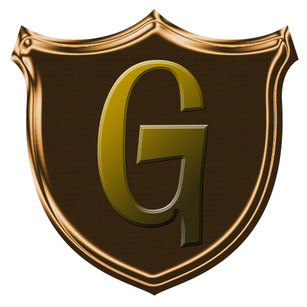

<div align="center">



# GnollHack

**A modern, cross-platform graphical roguelike built on the classic NetHack engine**

[](https://github.com/hyvanmielenpelit/GnollHack/releases)
[](https://wiki.gnollhack.com/Download)
[](https://wiki.gnollhack.com/Technological%20Features)
[](https://wiki.gnollhack.com/Development/Repository%20Structure)
[](LICENSE.md)
[](https://discord.gg/cQuExnzUQy)

[Website](https://gnollhack.com/) · [Wiki](https://wiki.gnollhack.com/) · [Features](https://wiki.gnollhack.com/Features) · [Developer Docs](https://wiki.gnollhack.com/Development%20Information) · [Gnoll Overseer AI Assistant](https://overseer.gnollhack.com/) · [Leaderboards](https://account.gnollhack.com/)

<br />

<a href="https://wiki.gnollhack.com/Screenshots">
  
</a>

<br />

<a href="https://store.steampowered.com/app/3558190/GnollHack/"></a>&nbsp;&nbsp;
<a href="https://play.google.com/store/apps/details?id=com.soundmindentertainment.gnollhack"></a>&nbsp;&nbsp;
<a href="https://apps.apple.com/app/gnollhack/id1626979951"></a>&nbsp;&nbsp;
<a href="https://github.com/hyvanmielenpelit/GnollHack/releases"></a>

</div>

## Overview

**GnollHack** is a turn-based, traditional roguelike role-playing game derived from [NetHack](https://github.com/NetHack/NetHack) 3.6.2. It preserves the deep gameplay of the original while modernizing presentation for desktop and mobile platforms.

On the gameplay side, GnollHack expands the classic formula with:
- Reagent-based spell system with 12 spell schools
- Item quality tiers and mythic/legendary affixes
- More interactive non-player characters and hirelings
- Seven difficulty levels
- Multiple gameplay modes ranging from classic permadeath to non-permadeath progression.
 
On the presentation side, it features:
- Graphical user interface
- Animated 2D tiles
- Original music
- Spatial sound effects
- Full voice acting

All assets have been created by human artists, composers, and voice actors without generative AI assets in the game.

| Area | Highlights | Documentation |
| :--- | :--- | :--- |
| **Visuals & Animation** | Over 23,000 hand-drawn 64×96 base tiles, monsters up to 192×192 pixels, animations, spells, rays, and explosions | [Features](https://wiki.gnollhack.com/Features) · [Screenshots](https://wiki.gnollhack.com/Screenshots) |
| **Audio & Voiceovers** | Over 1,100 sound effects powered by FMOD, 37 music tracks (14 original compositions), and 5,000+ lines recorded by 96 voice actors across 111 roles | [Overview](https://wiki.gnollhack.com/Overview) · [Features](https://wiki.gnollhack.com/Features) |
| **Expanded Mechanics** | 200+ spells across 14 levels, playable Gnoll race, level 50 progression cap, weapon set hot-swapping, and full in-game item and monster information | [Detailed Features](https://wiki.gnollhack.com/Detailed%20Features) |
| **Online Ecosystem** | Global leaderboards, cross-player bones file sharing, tournament integration, and the optional context-aware **Gnoll Overseer** AI game assistant | [GnollHack Account](https://wiki.gnollhack.com/GnollHack%20Account) · [Gnoll Overseer](https://wiki.gnollhack.com/Gnoll%20Overseer) |

## Architecture & Technology Stack

GnollHack bridges a multi-decade C roguelike engine with a modern, multi-threaded C# / .NET 10 MAUI frontend. The native C game loop runs on its own background thread and communicates with the managed UI and rendering pipeline through a bidirectional P/Invoke callback contract (`struct window_procs`), keeping rendering responsive at 60 FPS across desktop and mobile devices.

| Layer | Technology | Role in GnollHack |
| :--- | :--- | :--- |
| **Core Game Engine** | C99 | Extended NetHack 3.6.2 simulation core (~120 source files in `src/`, ~114 headers in `include/`) |
| **Native Bridge** | C / C# P/Invoke | Cross-platform interop layer (`win/win32/xpl/libshare/`) marshalling map layers, menus, and input events |
| **Cross-Platform Client** | .NET 10.0 MAUI (C# / XAML) | Unified application (`GnollHackM`) targeting Windows (WinUI 3), Android, and iOS / macOS (Apple Silicon) |
| **2D Graphics Engine** | SkiaSharp (Skia) | GPU-accelerated canvas rendering and multi-layer tile compositing |
| **Audio Middleware** | FMOD Studio | Low-latency cross-platform sound banks and audio playback |
| **Data Compilation Pipeline** | `makedefs`, `levcomp`, `dgncomp`, `dlb` | Build-time C tools that generate headers, compile `.des` level scripts into binary `.lev` files, and pack the `nhdat` archive |

## Repository Layout

```text
GnollHack/
├── dat/                 # Game data sources, text databases, and level descriptions (.des)
├── DEVEL/               # Coding style guidelines (code_style.txt) and performance benchmarks
├── doc/                 # Classic manual pages and guidebook sources
├── include/             # C core engine header files (.h)
├── src/                 # C core engine source files (.c)
├── sys/                 # Platform-specific bootstrap and system integration code
├── util/                # Build-time compilers and generators (makedefs, levcomp, dgncomp, dlb)
└── win/win32/           # Solutions, native wrappers, and cross-platform frontend code
    ├── vs/              # GnollHack.sln — C engine, build utilities, and native platform libraries
    └── xpl/             # Cross-platform client architecture
        ├── GnollHackM/      # GnollHackM.sln — .NET 10 MAUI client (Android, iOS, Windows WinUI 3)
        ├── GnollHackX/      # Shared C# game client logic, SkiaSharp renderer, and canonical XAML sources
        ├── gnollhackwin/    # Native Windows C library project (gnollhackwin.dll)
        ├── gnollhackdroid/  # Native Android C library project (libgnollhackdroid.so via WSL)
        ├── gnollhackios/    # Native iOS C library project (libgnollhackios.a via macOS build host)
        └── libshare/        # C native bridge connecting the C core to the C# frontend
```

## Building from Source

GnollHack uses a **two-solution build pipeline** in Visual Studio 2026:

1. **Native & Asset Pipeline (`win/win32/vs/GnollHack.sln`)** — Compiles the build utilities (`makedefs`, `levcomp`, `dgncomp`, `dlb`), processes game data into the `nhdat` archive, compiles the native C engine libraries (`gnollhackwin.dll`, `libgnollhackdroid.so`, `libgnollhackios.a`), transforms shared XAML views into `.NET MAUI` format, and stages external tile sheets and FMOD sound banks.
2. **Managed Client (`win/win32/xpl/GnollHackM/GnollHackM.sln`)** — Compiles and packages the `.NET 10.0 MAUI` frontend together with the staged native libraries and assets from Step 1.

Because tile sheets ([GnollHackTileSet](https://github.com/hyvanmielenpelit/GnollHackTileSet)) and FMOD sound banks ([GnollHackSoundSet](https://github.com/hyvanmielenpelit/GnollHackSoundSet)) are maintained in dedicated asset repositories, **read the architecture overview before building for the first time**:

- **[Development Information Hub](https://wiki.gnollhack.com/Development%20Information)** — Complete index of developer documentation
- **[Overview of Building GnollHack with .NET MAUI](https://wiki.gnollhack.com/Development/Overview%20of%20Building%20GnollHack%20with%20.NET%20MAUI)** — Essential prerequisite reading on how the C engine, WSL asset pipeline, and MAUI project interact
- **Platform Build Instructions**:
  - [Windows (WinUI 3 / .NET MAUI)](https://wiki.gnollhack.com/Development/Build%20Instructions%20for%20WinUI3%20Version%20on%20Windows%20%28.NET%20MAUI%29)
  - [Android on Windows (.NET MAUI)](https://wiki.gnollhack.com/Development/Build%20Instructions%20for%20Android%20Version%20on%20Windows%20%28.NET%20MAUI%29)
  - [iOS on Windows (.NET MAUI)](https://wiki.gnollhack.com/Development/Build%20Instructions%20for%20iOS%20Version%20on%20Windows%20%28.NET%20MAUI%29)

## Contributing & Community

- **Bug Reports & Issues** — Report bugs on the [GnollHack Discord server](https://discord.gg/cQuExnzUQy).
- **Art Contributions** — See the [Art Contribution Guidelines](https://wiki.gnollhack.com/Art%20Contribution%20Guidelines).
- **Communities** — Join the conversation on the [GnollHack Discord](https://discord.gg/cQuExnzUQy).

## License & Credits

- **Source Code** — Licensed under the **GnollHack General Public License / NetHack General Public License**. See [`LICENSE.md`](LICENSE.md) for the full license text.
- **Graphics, Sound Effects, Music & Voiceovers** — Licensed under the [Creative Commons Attribution-NonCommercial 4.0 International Public License (CC BY-NC 4.0)](https://creativecommons.org/licenses/by-nc/4.0/).

GnollHack is developed and maintained by **[Sound Mind Games](https://wiki.gnollhack.com/Developer)** (*[Hyvän mielen pelit ry](https://hyvanmielenpelit.fi/)*), a Finnish nonprofit organization working on the fields of gaming and mental health.

- [Credits](https://wiki.gnollhack.com/Credits)
- [Sponsor Sound Mind Games](https://hyvanmielenpelit.fi/tule-mukaan/pienkannatusjaseneksi/in-english)
